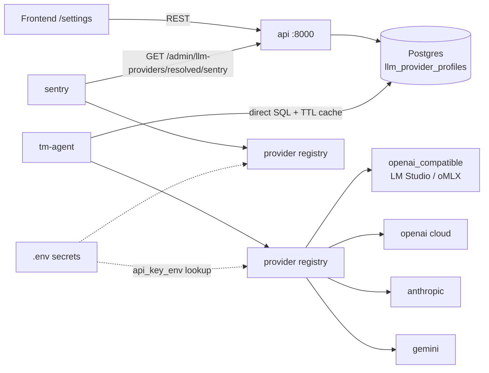

# Requirements

### Overview & Goals

Today every LLM call in Maestro'D goes through a hardcoded `ChatOpenAI` pointed at a single host endpoint (`INFERENCE_BASE_URL` / `LOCAL_MODEL`), which in practice means LM Studio or oMLX. The goal is to make the inference backend **pluggable**: multiple provider profiles (local OpenAI-compatible servers *and* cloud APIs), stored in the database, managed from an admin settings page, and assigned per role.

### Scope

**In scope**

- A provider abstraction supporting four provider kinds:
  - `openai_compatible` — LM Studio, oMLX, Ollama `/v1`, vLLM, OpenRouter, any gateway (current behaviour)
  - `openai` — official OpenAI cloud
  - `anthropic` — Claude
  - `gemini` — Google Generative AI
- Provider **profiles** persisted in Postgres (name, kind, base_url, model, api_key_env, temperature/max_tokens, timeout).
- **Per-role assignment**: `threats` (the tm-agent pipeline) and `sentry` (the chat assistant) can point at different profiles.
- **Admin settings UI** in the frontend: list / create / edit / delete profiles, assign roles, and a **Test connection** button.
- API keys are **never stored in the DB** — a profile references an environment variable *name* (`api_key_env`), the secret stays in `.env`.
- Provider-aware health check replacing the OpenAI-only `GET /models` probe.
- Backwards compatibility: with an empty settings table the system behaves exactly as today, seeded from the existing env vars.

**Out of scope**

- Live model-discovery dropdowns (model id is typed in; connection test reports what it found).
- Multi-tenant / per-user provider configuration.
- Per-pipeline-stage models (summary vs assets vs flows) — only the two roles above.
- Streaming, cost tracking, provider fallback chains.

### User Stories

- As an operator, I want to add an Anthropic or Gemini cloud profile from the UI so I can run the threat pipeline on a stronger model than my laptop can host.
- As an operator, I want the Sentry chat assistant to keep using my small local model while the threat pipeline uses a cloud model, so chat stays cheap and private.
- As an operator, I want to test a profile before activating it so I don't discover a bad base_url halfway through a pipeline run.
- As a security-conscious user, I want my cloud API keys to stay in `.env` and never land in a Postgres dump or a backup export.

### Functional Requirements

| ID | Requirement |
|----|-------------|
| R1 | `llm_provider_profiles` table stores provider profiles; `llm_role_bindings` maps role → profile |
| R2 | `GET/POST/PUT/DELETE /admin/llm-providers` CRUD on the `api` service |
| R3 | `PUT /admin/llm-providers/roles/{role}` binds a role (`threats`, `sentry`) to a profile |
| R4 | `GET /admin/llm-providers/resolved/{role}` returns the effective config **without** the secret value (used by `sentry`) |
| R5 | `POST /admin/llm-providers/{id}/test` performs a live round-trip and returns reachability, resolved model and latency |
| R6 | `api_key_env` must match an allowlist pattern (`INFERENCE_API_KEY` or `LLM_*`); arbitrary env names are rejected |
| R7 | API responses expose only `api_key_env` and a `key_present` boolean — never the secret |
| R8 | With no rows in the tables, `get_chat_model()` falls back to the existing `INFERENCE_BASE_URL` / `LOCAL_MODEL` / `INFERENCE_API_KEY` env config |
| R9 | `GET /inference/health` on tm-agent reports the resolved provider kind and model for the `threats` role |
| R10 | Frontend `/settings` page offers profile CRUD, role assignment and Test connection |
| R11 | Provider profiles are excluded from backup export/restore (they are environment-specific) |

### Non-Functional Requirements

- Resolution is cached in-process with a short TTL (~30 s) so a pipeline run does not hit Postgres/API per node.
- A misconfigured or unreachable profile fails with a clear, actionable error rather than a bare `openai.APIConnectionError`.
- Adding a provider SDK must not break the existing local-only, air-gapped deployment: the cloud SDKs are imported lazily.

# Technical Design

### Current Implementation

- [llm.py](air-file://u3hct587rh0uab50te8l/workspaces/maestro-d-threat-modeling/backend/agent/llm.py?type=file&root=%252F) — 14 lines, returns a `ChatOpenAI` built straight from env. Duplicated verbatim in [llm.py](air-file://u3hct587rh0uab50te8l/workspaces/maestro-d-threat-modeling/backend/sentry/llm.py?type=file&root=%252F).
- Every call site already funnels through `get_chat_model()`: [summary_worker.py](air-file://u3hct587rh0uab50te8l/workspaces/maestro-d-threat-modeling/backend/agent/summary_worker.py?type=file&root=%252F), [assets_worker.py](air-file://u3hct587rh0uab50te8l/workspaces/maestro-d-threat-modeling/backend/agent/assets_worker.py?type=file&root=%252F), [flows_worker.py](air-file://u3hct587rh0uab50te8l/workspaces/maestro-d-threat-modeling/backend/agent/flows_worker.py?type=file&root=%252F), [flow_scan_worker.py](air-file://u3hct587rh0uab50te8l/workspaces/maestro-d-threat-modeling/backend/agent/flow_scan_worker.py?type=file&root=%252F), [threats_subgraph.py](air-file://u3hct587rh0uab50te8l/workspaces/maestro-d-threat-modeling/backend/agent/threats_subgraph.py?type=file&root=%252F), [threats_agent.py](air-file://u3hct587rh0uab50te8l/workspaces/maestro-d-threat-modeling/backend/agent/threats_agent.py?type=file&root=%252F), [chat.py](air-file://u3hct587rh0uab50te8l/workspaces/maestro-d-threat-modeling/backend/sentry/chat.py?type=file&root=%252F). **This is the key enabler — one seam to replace.**
- [inference.py](air-file://u3hct587rh0uab50te8l/workspaces/maestro-d-threat-modeling/backend/agent/inference.py?type=file&root=%252F) probes `GET {base_url}/models`, an OpenAI-only assumption.
- `MODEL_PROVIDER` exists in [.env.example](air-file://u3hct587rh0uab50te8l/workspaces/maestro-d-threat-modeling/.env.example?type=file&root=%252F) but is **read nowhere** — dead config.
- Containers: `api` (owns SQLAlchemy models + Alembic), `tm-agent` (has its own `SessionLocal` in [db.py](air-file://u3hct587rh0uab50te8l/workspaces/maestro-d-threat-modeling/backend/agent/db.py?type=file&root=%252F) and runs raw SQL), `sentry` (no `DATABASE_URL`; reaches `api` via `THREAT_API_URL`). Each service has its own Docker build context, so code is duplicated between `backend/agent` and `backend/sentry` by convention.

### Key Decisions

1. **Keep `get_chat_model()` as the single seam.** It gains an optional `role` argument and a provider registry behind it; no worker file changes except `summary_worker`/`chat` if we want explicit roles. Minimal blast radius.
2. **`api` owns the schema; tm-agent reads the DB directly, sentry reads over HTTP.** Matches each container's existing access pattern — tm-agent already runs raw SQL against Postgres, sentry already has no DB credentials.
3. **Secrets by reference, not by value.** The DB holds `api_key_env` (a variable *name*); the resolver does `os.getenv(name)`. Nothing secret ever enters Postgres, backups, or API responses. An allowlist (`INFERENCE_API_KEY`, `LLM_*`) prevents a crafted profile from exfiltrating e.g. `POSTGRES_PASSWORD` via the test endpoint.
4. **Lazy provider imports.** `langchain_anthropic` / `langchain_google_genai` are imported inside their factory functions, so a local-only install that never selects them is unaffected if the wheel is missing.
5. **Env fallback preserved.** Empty tables → legacy env behaviour. No forced migration for existing users.

### Architecture Diagram



### Data Models / Contracts

```python

# backend/api/models.py

class LlmProviderProfile(Base):
    __tablename__ = "llm_provider_profiles"
    id = Column(UUID(as_uuid=True), primary_key=True, default=uuid.uuid4)
    name = Column(String(128), nullable=False, unique=True)
    kind = Column(String(32), nullable=False)      # openai_compatible|openai|anthropic|gemini
    base_url = Column(String(512), nullable=True)  # required for openai_compatible
    model = Column(String(256), nullable=False)
    api_key_env = Column(String(128), nullable=True)
    temperature = Column(Float, nullable=True)
    max_tokens = Column(Integer, nullable=True)
    timeout_sec = Column(Integer, nullable=False, default=180)
    created_at / updated_at = ...

class LlmRoleBinding(Base):
    __tablename__ = "llm_role_bindings"
    role = Column(String(32), primary_key=True)    # "threats" | "sentry"
    profile_id = Column(UUID, ForeignKey("llm_provider_profiles.id", ondelete="RESTRICT"))
```

```python

# shared contract (duplicated in backend/agent and backend/sentry)

@dataclass(frozen=True)
class ProviderConfig:
    kind: str; model: str; base_url: str | None
    api_key: str | None; temperature: float | None
    max_tokens: int | None; timeout_sec: float

def build_chat_model(cfg: ProviderConfig) -> BaseChatModel: ...
def resolve_config(role: str) -> ProviderConfig:  # DB/API + TTL cache + env fallback
def get_chat_model(role: str = "threats") -> BaseChatModel:
    return build_chat_model(resolve_config(role))
```

REST shapes:

```
GET    /admin/llm-providers              -> [{id, name, kind, base_url, model, api_key_env, key_present, ...}]
POST   /admin/llm-providers              <- {name, kind, base_url?, model, api_key_env?, ...}
PUT    /admin/llm-providers/{id}
DELETE /admin/llm-providers/{id}          -> 409 if bound to a role
GET    /admin/llm-providers/roles         -> {threats: {...}|null, sentry: {...}|null}
PUT    /admin/llm-providers/roles/{role}  <- {profile_id}
GET    /admin/llm-providers/resolved/{role} -> ProviderConfig minus api_key, plus key_present
POST   /admin/llm-providers/{id}/test     -> {ok, latency_ms, detail|error}
```

### File Structure

**New**

- `backend/api/routes/llm_providers.py` — CRUD + roles + test, mirroring the style of [admin.py](air-file://u3hct587rh0uab50te8l/workspaces/maestro-d-threat-modeling/backend/api/routes/admin.py?type=file&root=%252F)
- `backend/api/services/llm_provider_service.py` — validation, allowlist, resolution, connection test
- `backend/api/alembic/versions/003_llm_providers.py`
- `backend/agent/llm_providers.py` — provider registry (`build_chat_model`)
- `backend/agent/llm_settings.py` — DB-backed `resolve_config` + TTL cache + env fallback
- `backend/sentry/llm_providers.py` — same registry (duplicated per build-context convention)
- `backend/sentry/llm_settings.py` — HTTP-backed `resolve_config` against `THREAT_API_URL`
- `frontend/src/pages/SettingsPage.tsx`
- `test/test_llm_providers.py`, `test/test_llm_settings_resolution.py`

**Modified**

- `backend/agent/llm.py`, `backend/sentry/llm.py` — delegate to registry, add `role` parameter
- `backend/agent/inference.py` — provider-aware health
- `backend/agent/summary_worker.py` etc. keep calling `get_chat_model()` (default role) — no change needed; `backend/sentry/chat.py` passes `role="sentry"`
- `backend/api/models.py`, `backend/api/schemas.py`, `backend/api/main.py` (router registration)
- `backend/api/services/backup_service.py` — exclude provider tables
- both `requirements.txt` — add `langchain-anthropic`, `langchain-google-genai`
- `frontend/src/api/client.ts`, `frontend/src/App.tsx`, `frontend/src/components/Layout.tsx` (nav link), `frontend/src/types.ts`
- `.env.example`, `docker-compose.yml` (pass `LLM_*` keys + `DATABASE_URL` already present for agent)
- Docs: `README.md` (stack table line 75), `docs/dev/endpoints.md`, `docs/dev/dependencies.md`, `docs/backlog.md`, `slicedworkload.md`, new `docs/specs/slice-020-pluggable-llm-providers.md`

### Risks

| Risk | Mitigation |
|------|-----------|
| `api_key_env` used to read arbitrary env (e.g. `POSTGRES_PASSWORD`) | Strict allowlist regex `^(INFERENCE_API_KEY\|LLM_[A-Z0-9_]+)$`, validated on write **and** on resolve |
| Settings lookup on every LLM node adds latency / DB load | 30 s TTL in-process cache, invalidated on process restart; pipeline resolves once per worker call |
| Cloud SDK wheels bloat the local-only image | Lazy import inside each factory; failure yields "provider X requires package Y" instead of a crash at import time |
| Changing provider mid-run gives inconsistent models across pipeline stages | Acceptable for now; TTL keeps the window small — documented |
| Non-OpenAI providers reject OpenAI-shaped structured-output calls used in [structured_tool_json.py](air-file://u3hct587rh0uab50te8l/workspaces/maestro-d-threat-modeling/backend/agent/structured_tool_json.py?type=file&root=%252F) | Validate each new provider against the existing text-block parsers; keep the text-parser fallback path that already exists |
| Sentry cannot reach `api` at startup | Fall back to env config and log a warning rather than failing the container |

# Documentation Audit

State of the docs as of this plan, and what each one needs.

| Doc | Current state | Required update |
|-----|---------------|-----------------|
| `README.md` | Stack table row 75: *"LLM — Host endpoint only (`INFERENCE_BASE_URL`) — LM Studio / oMLX"* | Rewrite the row to "pluggable providers (OpenAI-compatible / OpenAI / Anthropic / Gemini), configured in `/settings`"; keep the local-first framing in the intro |
| `docs/dev/endpoints.md` | Only covers the **Builder** (oMLX script) and **Product** lanes for local inference; no REST endpoint catalogue | Add a "Provider configuration" section: the `/admin/llm-providers` routes, the four `kind` values and their required fields, and the `api_key_env` indirection |
| `docs/dev/dependencies.md` | Canonical pin table; lists `backend/agent/requirements.txt` verbatim, last `pip-audit` 2026-06-08 | Add pinned `langchain-anthropic` and `langchain-google-genai` rows and update both inlined requirements blocks; note they are optional/lazy-imported |
| `.env.example` | Has `MODEL_PROVIDER=ollama` which is **read nowhere** in the code | Make `MODEL_PROVIDER` meaningful (default `kind` for the env fallback) and add commented `LLM_OPENAI_API_KEY` / `LLM_ANTHROPIC_API_KEY` / `LLM_GEMINI_API_KEY` |
| `docs/specs/` | Numbered slice specs end at `slice-019-security-hardening-p1.md` | New spec `docs/specs/slice-020-pluggable-llm-providers.md` following the slice-003a format (goal, allowed files, acceptance) |
| `slicedworkload.md` | "Active slice" table says 019 pending; history/status table ends at 018 | Add slice 020 to the status + history tables and point "Active slice" at it once 019 lands |
| `docs/backlog.md` | No LLM-provider item at all | Add a "Pluggable LLM providers" row under P1 linking to slice-020 |
| `docs/qa/` | Verify passes end at `verify-pass-012-018.md` | Add `verify-pass-020.md` after the test run, matching the existing format |

**Dependency note:** slice-019 (admin auth / `ADMIN_API_KEY`, removing `VITE_INTERNAL_API_KEY` from the browser) is still open. The new admin routes reuse the existing `require_internal_key` guard from `backend/api/security.py` and must be included in whatever slice-019 changes land, so the settings page does not become an unauthenticated write surface.

# Testing

### Validation Approach

Extend the existing pytest suite in [test](air-file://u3hct587rh0uab50te8l/workspaces/maestro-d-threat-modeling/test?type=folder&root=%252F), following the unit-test-only convention from `agents.md`. No live cloud calls — provider construction is asserted on the returned object's type and attributes, and HTTP/DB resolution is monkeypatched.

### Key Scenarios

- Empty settings tables → `resolve_config("threats")` returns the legacy env config and `get_chat_model()` yields a `ChatOpenAI` with the old base_url (regression guard for today's behaviour).
- A `openai_compatible` profile in the DB overrides env for the `threats` role.
- Each of the four `kind` values maps to the expected chat-model class with model/temperature/timeout wired through.
- Role separation: `threats` and `sentry` bound to different profiles each resolve to their own model.
- CRUD endpoints round-trip a profile; `GET` never contains the secret value, only `api_key_env` + `key_present`.
- `DELETE` of a role-bound profile returns 409.
- `GET /inference/health` reports provider kind and model from the resolved config.

### Edge Cases

- `api_key_env` outside the allowlist → 422 on create and ignored on resolve.
- `openai_compatible` without `base_url` → 422.
- Unknown `kind` → 422 on write, clear `ValueError` in the registry.
- Missing provider SDK → actionable error message naming the package.
- Sentry cannot reach `api` → falls back to env config, logs a warning, chat still works.
- Backup export contains no `llm_provider_profiles` rows; restore of an old backup is unaffected.
- TTL cache: two successive `resolve_config` calls hit the store once.

### Test Changes

- New: `test/test_llm_providers.py` (registry + API CRUD), `test/test_llm_settings_resolution.py` (role resolution, fallback, cache, allowlist).
- Updated: [test_inference.py](air-file://u3hct587rh0uab50te8l/workspaces/maestro-d-threat-modeling/test/test_inference.py?type=file&root=%252F) for the new health payload fields, keeping the existing skip-when-offline guard.

# Delivery Steps

###   Step 1: Introduce the provider registry behind get_chat_model()
All LLM construction goes through a provider registry that can build OpenAI-compatible, OpenAI cloud, Anthropic and Gemini models, with today's env behaviour unchanged.

- Add `backend/agent/llm_providers.py` defining the `ProviderConfig` dataclass and `build_chat_model(cfg)` with a `kind -> factory` registry.
- Implement four factories: `openai_compatible` (ChatOpenAI + base_url), `openai` (ChatOpenAI, no base_url), `anthropic` (ChatAnthropic), `gemini` (ChatGoogleGenerativeAI); import the cloud SDKs lazily inside each factory with a clear error if the package is missing.
- Add `backend/agent/llm_settings.py` with `resolve_config(role)` that, for now, only reads env (`INFERENCE_BASE_URL`, `LOCAL_MODEL`, `INFERENCE_API_KEY`, `INFERENCE_REQUEST_TIMEOUT_SEC`) and maps the previously-dead `MODEL_PROVIDER` onto a `kind`.
- Rewrite `backend/agent/llm.py` so `get_chat_model(role="threats")` = `build_chat_model(resolve_config(role))`; worker call sites stay untouched.
- Mirror `llm_providers.py` / `llm_settings.py` into `backend/sentry/` and update `backend/sentry/llm.py`; `backend/sentry/chat.py` passes `role="sentry"`.
- Add `langchain-anthropic` and `langchain-google-genai` to both `requirements.txt` files.
- Add `test/test_llm_providers.py` covering each kind and the unchanged legacy env path.

###   Step 2: Persist provider profiles and role bindings in Postgres
Provider profiles and role bindings exist as real tables with an Alembic migration, and are excluded from backups.

- Add `LlmProviderProfile` and `LlmRoleBinding` models to `backend/api/models.py` following the existing UUID/timestamp column conventions.
- Create `backend/api/alembic/versions/003_llm_providers.py` with upgrade/downgrade, revision chained after `002_audit_log`.
- Add Pydantic request/response schemas to `backend/api/schemas.py`; responses expose `api_key_env` and `key_present`, never the secret.
- Implement `backend/api/services/llm_provider_service.py`: create/update/delete with validation (`base_url` required for `openai_compatible`, known `kind`, `api_key_env` matching the `^(INFERENCE_API_KEY|LLM_[A-Z0-9_]+)$` allowlist), role binding, and `resolve(role)` with env fallback.
- Update `backend/api/services/backup_service.py` so the new tables are not exported or restored.

###   Step 3: Expose admin endpoints for CRUD, role binding and connection test
The api service serves `/admin/llm-providers` CRUD, role assignment, resolved-config lookup and a live connection test.

- Add `backend/api/routes/llm_providers.py` with GET/POST/PUT/DELETE on `/admin/llm-providers`, `GET/PUT /admin/llm-providers/roles[/{role}]`, and `GET /admin/llm-providers/resolved/{role}`.
- Return 409 when deleting a profile that is bound to a role.
- Implement `POST /admin/llm-providers/{id}/test`: resolve the config, perform a minimal provider-appropriate round trip (model list for OpenAI-compatible, a 1-token completion otherwise) with a short timeout, and return `{ok, latency_ms, detail|error}`.
- Register the router in `backend/api/main.py` alongside the existing admin router, protecting every mutating route with the existing `require_internal_key` dependency from `backend/api/security.py`.
- Add API-level tests to `test/test_llm_providers.py`: round-trip CRUD, secret never returned, allowlist rejection, 409 on bound delete.

###   Step 4: Wire tm-agent and sentry to the stored configuration
The threat pipeline resolves its model from Postgres and Sentry resolves its model over HTTP, both with a TTL cache and env fallback.

- Extend `backend/agent/llm_settings.py` to query `llm_role_bindings`/`llm_provider_profiles` via the existing `SessionLocal` from `backend/agent/db.py` using raw SQL, resolving the secret with `os.getenv(api_key_env)` behind the same allowlist check.
- Extend `backend/sentry/llm_settings.py` to fetch `GET {THREAT_API_URL}/admin/llm-providers/resolved/sentry` via httpx, resolving the key locally from env.
- Add a 30-second in-process TTL cache to both resolvers; on any store/transport failure log a warning and fall back to env config.
- Rework `backend/agent/inference.py` so `/inference/health` reports the resolved provider kind, model and source (`db` vs `env`), using a provider-appropriate probe instead of the hardcoded `/models` call.
- Add `test/test_llm_settings_resolution.py` for DB override, role separation, cache hit count, allowlist enforcement and fallback-on-failure; update `test/test_inference.py` for the new payload.

###   Step 5: Add the frontend settings page
Operators can manage provider profiles, assign roles and test connections from `/settings` in the UI.

- Add typed client functions to `frontend/src/api/client.ts` for list/create/update/delete, role get/set, and the test endpoint; add the corresponding interfaces to `frontend/src/types.ts`.
- Create `frontend/src/pages/SettingsPage.tsx`: a table of profiles, a create/edit form whose fields adapt to the selected `kind` (base_url only for `openai_compatible`), a `key_present` indicator next to `api_key_env`, and a per-profile Test connection button showing ok/latency/error.
- Add role selectors for `threats` and `sentry` that bind to an existing profile.
- Register the `/settings` route in `frontend/src/App.tsx` and add a nav link in `frontend/src/components/Layout.tsx`.

###   Step 6: Update configuration, compose and documentation
A fresh checkout documents how to point Maestro'D at a cloud provider, compose passes the needed secrets through, and every stale doc from the audit is corrected.

- Update `.env.example`: make `MODEL_PROVIDER` meaningful (default `kind` for the env fallback), add commented `LLM_OPENAI_API_KEY` / `LLM_ANTHROPIC_API_KEY` / `LLM_GEMINI_API_KEY`, and explain the `api_key_env`-by-reference model.
- Update `docker-compose.yml` to pass the `LLM_*` variables into `tm-agent` and `sentry`, and confirm `THREAT_API_URL` is set for sentry.
- Rewrite the LLM row in the `README.md` stack table so it describes pluggable providers instead of "Host endpoint only".
- Add a "Provider configuration" section to `docs/dev/endpoints.md`: the `/admin/llm-providers` routes, the four `kind` values with their required fields, and the `api_key_env` indirection.
- Add pinned `langchain-anthropic` and `langchain-google-genai` rows to `docs/dev/dependencies.md` and refresh the inlined `backend/agent` / `backend/sentry` requirements blocks.
- Write `docs/specs/slice-020-pluggable-llm-providers.md` in the slice-003a format (goal, allowed files, acceptance criteria).
- Register slice 020 in the `slicedworkload.md` status/history tables and add a P1 "Pluggable LLM providers" row to `docs/backlog.md` linking to the spec.
- Record the test run as `docs/qa/verify-pass-020.md`, matching the existing verify-pass format.